<!-- ═══════════════════════════════════════════════════════════════════════ -->
<!--  MUHAMMAD AFFAN · GitHub Profile README                                -->
<!--  Every project, screenshot, link and stat below points at something    -->
<!--  real. Custom animated SVGs live in /assets.                           -->
<!-- ═══════════════════════════════════════════════════════════════════════ -->

<p align="center">
  <a href="https://affann-portfolio.vercel.app/">
    
  </a>
</p>

<p align="center">
  
</p>

<p align="center">
  <a href="https://github.com/Muhammadd-01?tab=followers"></a>
  
  <a href="https://github.com/Muhammadd-01?tab=repositories"></a>
  
</p>

<p align="center">
  <a href="https://affann-portfolio.vercel.app/"></a>
  <a href="https://www.linkedin.com/in/muhammad-affan-8ab604280"></a>
  <a href="mailto:affan.work05@gmail.com"></a>
  <a href="https://x.com/affann_23"></a>
  <a href="https://www.instagram.com/almuharib._.7/"></a>
  <a href="https://www.facebook.com/profile.php?id=61572493182768"></a>
</p>


<h2> About Me</h2>

I'm **Muhammad Affan**, a full-stack developer, UI/UX enthusiast and the **Founder & CEO of [NexoVate Digital](https://nexovate-digital.vercel.app/)**, based in **Karachi, Pakistan 🇵🇰**. I build complete products end to end: web apps with **React, Next.js and Node**, cross-platform mobile apps with **Flutter**, and **Python + FastAPI** services that put machine learning behind a clean, fast interface.

I care about the details users feel: **clean UI, smooth motion, solid performance and scalable architecture**. Alongside client work I'm a **Teacher Assistant at Aptech**, helping students with programming logic, debugging and real-world projects, and I'm completing my **Advanced Diploma in Software Engineering (ADSE)**.

| 💼 Role | 🧑‍🏫 Also | 🎓 Studying | 🗣️ Languages | 📦 On GitHub |
|:---:|:---:|:---:|:---:|:---:|
| Founder & CEO,<br>NexoVate Digital | Teacher Assistant,<br>Aptech (2024 →) | ADSE, Software<br>Engineering | Urdu (native),<br>English (fluent) | 100+ public repos<br>since May 2024 |

```ts
const affan = {
  builds:   ["Web apps", "Mobile apps", "AI tools", "Games"],
  stack:    ["MERN", "Next.js", "Flutter", "FastAPI"],
  designs:  ["Figma", "Design systems", "Motion UI"],
  learning: ["Unity 6", "Local LLMs", "System design"],
  outside:  ["Islamic history", "Psychology", "Strategy games"],
  motto:    "Ummah first ☝️ · Lifelong learner 📚",
};
```

<h2> My Journey</h2>

<p align="center">
  
</p>


<h2> NexoVate Digital</h2>

<table>
  <tr>
    <td width="42%" valign="middle">
      <br>
      <b>NexoVate Digital</b> is my software studio. We design and build <b>websites, web apps, mobile apps and AI tools</b> for businesses and individuals, from the first wireframe to deployment.<br><br>
      ✦ UI/UX design &amp; branding<br>
      ✦ Full-stack web &amp; SaaS platforms<br>
      ✦ Flutter mobile apps<br>
      ✦ AI automation &amp; data dashboards<br><br>
      <a href="https://nexovate-digital.vercel.app/"></a>
    </td>
    <td width="58%" valign="middle">
      <a href="https://nexovate-digital.vercel.app/">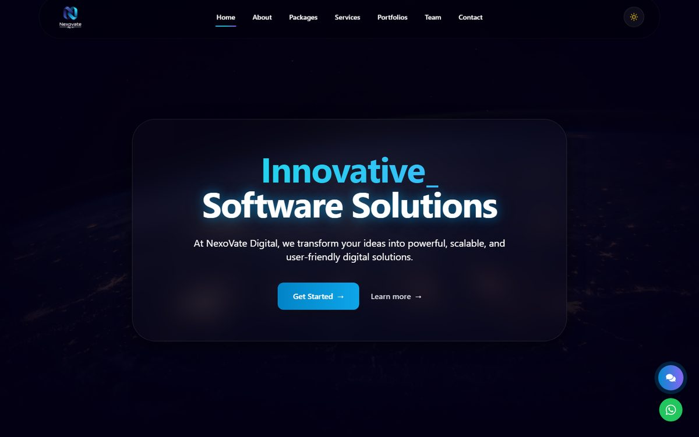</a>
    </td>
  </tr>
</table>


<h2> Featured Projects</h2>

<p align="center">
  
</p>

<table>
  <tr>
    <td width="50%" valign="top">
      <a href="https://urban-transit-iq.vercel.app">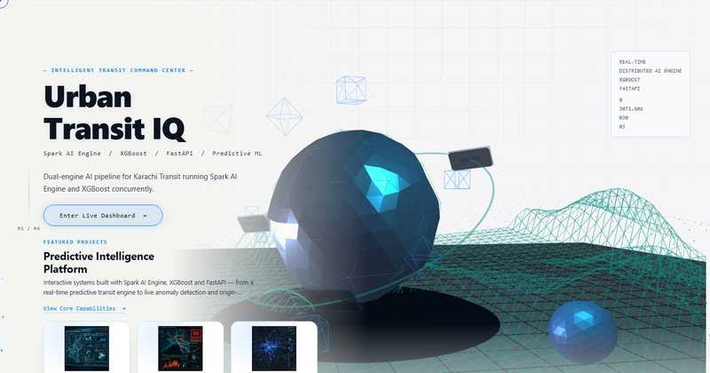</a>
      <h3>🚊 UrbanTransit IQ</h3>
      Big-data transit intelligence platform for Karachi: travel patterns, anomaly detection and route clustering with <b>PySpark MLlib</b>, served through <b>FastAPI</b> and a React dashboard.<br><br>
      
      
      
      <br><br>
      <a href="https://urban-transit-iq.vercel.app"><b>🌐 Live demo</b></a> · <a href="https://github.com/Muhammadd-01/UrbanTransit_IQ"><b>📂 Code</b></a>
    </td>
    <td width="50%" valign="top">
      <a href="https://github.com/Muhammadd-01/WatchHub_Project">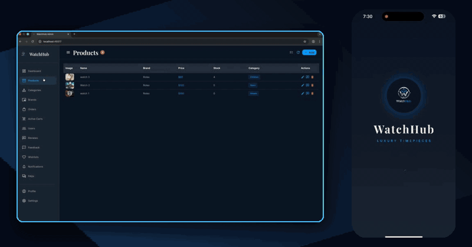</a>
      <h3>⌚ WatchHub</h3>
      Luxury watch e-commerce platform: a cross-platform customer app for iOS &amp; Android plus a web admin panel for products, orders, users and reviews.<br><br>
      
      
      
      <br><br>
      <a href="https://github.com/Muhammadd-01/WatchHub_Project"><b>📂 Code &amp; demo videos</b></a>
    </td>
  </tr>
  <tr>
    <td width="50%" valign="top">
      <a href="https://github.com/Muhammadd-01/ProfitLens"></a>
      <h3>📈 ProfitLens</h3>
      AI business-intelligence SaaS for small businesses: upload sales data and get forecasting, churn prediction, RFM + K-Means customer segmentation and anomaly detection.<br><br>
      
      
      
      <br><br>
      <a href="https://github.com/Muhammadd-01/ProfitLens"><b>📂 Code</b></a>
    </td>
    <td width="50%" valign="top">
      <a href="https://github.com/Muhammadd-01/Pixel_Punch"></a>
      <h3>🥊 PixelPunch</h3>
      Cartoon 2D fighting &amp; exploration game with Solo / Duo / Squad modes, a <b>Villain Lab</b> that turns a selfie into a playable villain with on-device ML Kit, and a Unity 3D royale mode.<br><br>
      
      
      
      <br><br>
      <a href="https://github.com/Muhammadd-01/Pixel_Punch"><b>📂 Code</b></a>
    </td>
  </tr>
  <tr>
    <td width="50%" valign="top">
      <a href="https://github.com/Muhammadd-01/Scorpian_Cursor"></a>
      <h3>🦂 Scorpion Cursor</h3>
      macOS desktop companion: an articulated, animated scorpion that chases your cursor across every app and Space, with sprint mode and live resizing. Native Swift helper for global mouse tracking.<br><br>
      
      
      
      <br><br>
      <a href="https://github.com/Muhammadd-01/Scorpian_Cursor"><b>📂 Code</b></a>
    </td>
    <td width="50%" valign="top">
      <a href="https://github.com/Muhammadd-01/Storelytics"></a>
      <h3>📦 Storelytics</h3>
      Retail analytics for pharmacies and general stores: inventory, profit tracking, expiry &amp; low-stock alerts, demand logging and PDF reports with role-based access.<br><br>
      
      
      <br><br>
      <a href="https://github.com/Muhammadd-01/Storelytics"><b>📂 Code</b></a>
    </td>
  </tr>
  <tr>
    <td width="50%" valign="top">
      <a href="https://github.com/Muhammadd-01/AI_Researcher"></a>
      <h3>🔎 AI Researcher</h3>
      Autonomous research agent that gathers articles, repos and videos on any topic and summarises them with a <b>local LLM</b> (Qwen2.5) running in-memory, with no paid APIs.<br><br>
      
      
      
      <br><br>
      <a href="https://github.com/Muhammadd-01/AI_Researcher"><b>📂 Code</b></a>
    </td>
    <td width="50%" valign="top">
      <a href="https://github.com/Muhammadd-01/Hotel_Management_System"></a>
      <h3>🏨 AI Hotel Management System</h3>
      MERN hotel system with JWT auth, room &amp; booking management, dynamic pricing, Socket.io notifications, PDF invoices and a smart booking assistant that understands English &amp; Roman Urdu.<br><br>
      
      
      
      <br><br>
      <a href="https://github.com/Muhammadd-01/Hotel_Management_System"><b>📂 Code</b></a>
    </td>
  </tr>
</table>

<h2> Live Project Gallery</h2>

<p><em>Real screenshots of sites I've built and deployed. Click any screen to open it live.</em></p>

<table>
  <tr>
    <td width="33%" align="center" valign="top">
      <a href="https://deen-sphere.vercel.app">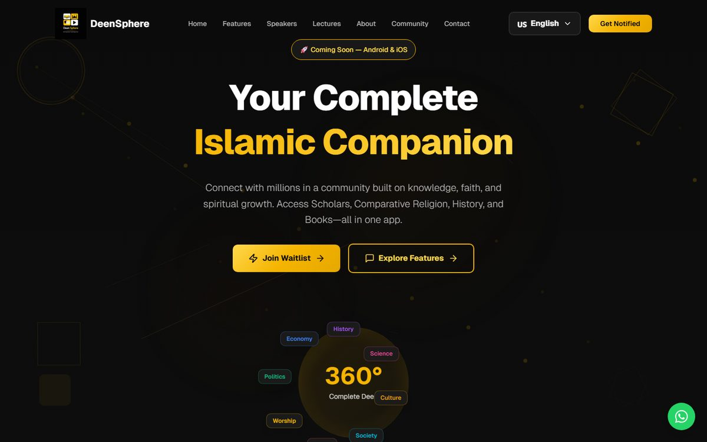</a><br>
      <b>DeenSphere</b><br><sub>Islamic knowledge &amp; community platform</sub><br>
      <a href="https://deen-sphere.vercel.app">Live</a> · <a href="https://github.com/Muhammadd-01/Deen_Sphere_Website">Code</a>
    </td>
    <td width="33%" align="center" valign="top">
      <a href="https://meridian-quality-management.vercel.app">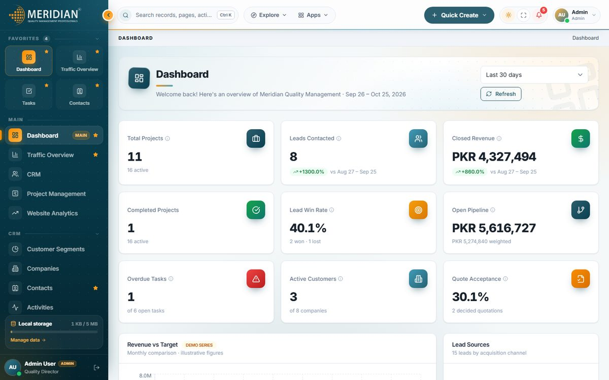</a><br>
      <b>Meridian QM Workspace</b><br><sub>CRM, sales pipeline &amp; reports for ISO consultants</sub><br>
      <a href="https://meridian-quality-management.vercel.app">Live</a> · <a href="https://github.com/Muhammadd-01/Meridian-Quality-Management">Code</a>
    </td>
    <td width="33%" align="center" valign="top">
      <a href="https://meqmp.vercel.app">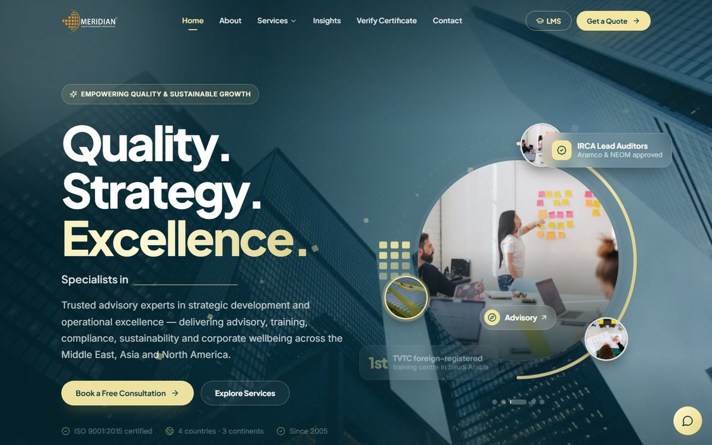</a><br>
      <b>Meridian QMP</b><br><sub>Corporate website for a quality-advisory firm</sub><br>
      <a href="https://meqmp.vercel.app">Live</a> · <a href="https://github.com/Muhammadd-01/Meqmp">Code</a>
    </td>
  </tr>
  <tr>
    <td width="33%" align="center" valign="top">
      <a href="https://deen-verse.vercel.app">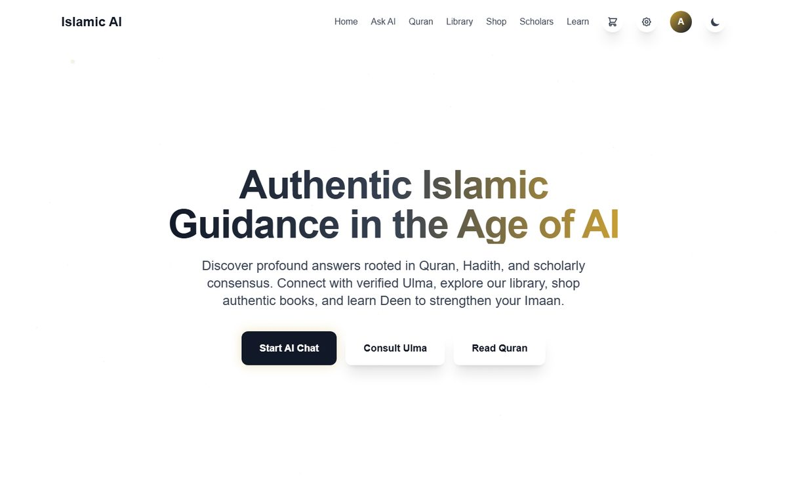</a><br>
      <b>DeenVerse</b><br><sub>Islamic AI platform (React + Vite)</sub><br>
      <a href="https://deen-verse.vercel.app">Live</a> · <a href="https://github.com/Muhammadd-01/Islamic-Project">Code</a>
    </td>
    <td width="33%" align="center" valign="top">
      <a href="https://medinova-admin-panel.vercel.app">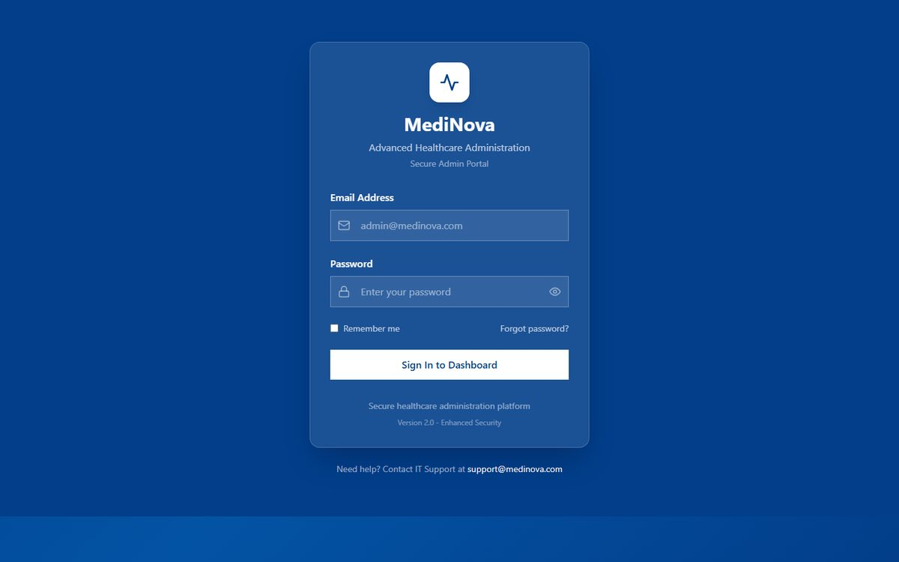</a><br>
      <b>MediNova Admin</b><br><sub>Healthcare administration dashboard</sub><br>
      <a href="https://medinova-admin-panel.vercel.app">Live</a> · <a href="https://github.com/Muhammadd-01/MediNova_AdminPanel">Code</a>
    </td>
    <td width="33%" align="center" valign="top">
      <a href="https://affann-portfolio.vercel.app/">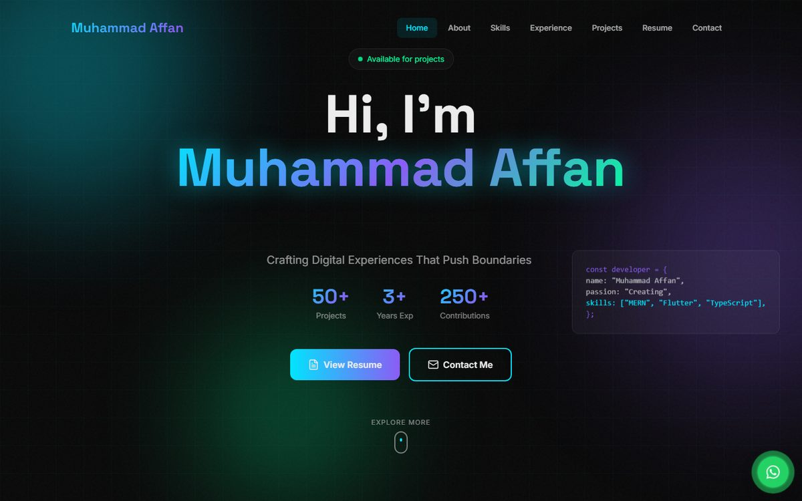</a><br>
      <b>Portfolio</b><br><sub>Next.js 14 · Framer Motion · tsParticles</sub><br>
      <a href="https://affann-portfolio.vercel.app/">Live</a> · <a href="https://github.com/Muhammadd-01/Affan-sPortolio">Code</a>
    </td>
  </tr>
</table>

<details>
  <summary><b>📱 The "Sphere" Flutter app ecosystem and more (click to expand)</b></summary>
  <br>

A family of Flutter + Firebase apps I'm building around community needs (test APKs on my [portfolio](https://affann-portfolio.vercel.app/)):

| App | Purpose |
|---|---|
| **DeenSphere** | Islamic super-app: Quran, Hadith, Duas, Tasbeeh, Qibla & community |
| **DonateSphere** | Zakat, Sadaqah & charity with impact videos |
| **TradeSphere** | Halal marketplace to buy, sell & trade ethically |
| **HealthSphere** | Sunnah remedies & daily health tracking |
| **LegacySphere** | Islamic inheritance calculator & will builder |
| **HalalSphere** | Community-verified halal food & product guide |
| **MindBloom** | Behavioural AI & positivity companion with sentiment analysis |
| **GuardianLink** | Cross-platform emergency safety network |

Also on GitHub: [FakeGuardAI](https://github.com/Muhammadd-01/Fake_AI_News_Detector) (fake-news detection), [JobSeeking AI](https://github.com/Muhammadd-01/jobSeekingAI) (React Native CV-to-job matcher), [Rage Hunters](https://github.com/Muhammadd-01/Rage_Hunters) (Unity 6 multiplayer survival), [Meridian LMS](https://github.com/Muhammadd-01/Meridian_LMS) (course marketplace demo).

</details>


<h2> UI/UX &amp; Design</h2>

<p align="center">
  
</p>

Design isn't a coat of paint at the end. I start every project with the user's flow, then build a small design system and carry it into code.

<table>
  <tr>
    <td width="50%" valign="top">

**🎯 Principles I design by**

- **Clarity first:** clear hierarchy, one primary action per screen
- **Responsive by default:** mobile, tablet and desktop from the first frame
- **Motion with purpose:** micro-interactions that guide, never distract
- **Systems over screens:** tokens for colour, type, spacing and radius
- **Accessible:** AA contrast, readable type, keyboard-friendly UI
- **Fast:** lazy loading, optimised assets, smooth 60 fps animation

</td>
    <td width="50%" valign="top">

**🧰 Design & motion toolkit**


**Styles I love:** glassmorphism, dark-first themes, cinematic hero sections, 3D accents and data-dense dashboards that stay calm.

</td>
  </tr>
</table>


<h2> Tech Stack</h2>

<table>
  <tr><td><b>Languages</b></td><td></td></tr>
  <tr><td><b>Frontend</b></td><td></td></tr>
  <tr><td><b>Mobile · Desktop · Games</b></td><td></td></tr>
  <tr><td><b>Backend · AI</b></td><td></td></tr>
  <tr><td><b>Data · Cloud</b></td><td></td></tr>
  <tr><td><b>Tools</b></td><td></td></tr>
</table>


<h2> GitHub Stats</h2>

<p align="center">
  
  
</p>

<p align="center">
  
</p>

<h3> Contributions in 3D</h3>

<p align="center">
  
</p>

<h3> Contribution Snake</h3>

<p align="center">
  <picture>
    <source media="(prefers-color-scheme: dark)" srcset="https://raw.githubusercontent.com/Muhammadd-01/Muhammadd-01/output/github-snake-dark.svg">
    <source media="(prefers-color-scheme: light)" srcset="https://raw.githubusercontent.com/Muhammadd-01/Muhammadd-01/output/github-snake.svg">
    
  </picture>
</p>


<h2 align="center"> Let's Build Something Together</h2>

<p align="center">
  Have a project in mind, need a website or app for your business, or want to collaborate on open source?<br>
  <a href="mailto:affan.work05@gmail.com"><b>Email me</b></a>, message me on <a href="https://www.linkedin.com/in/muhammad-affan-8ab604280"><b>LinkedIn</b></a>, or visit <a href="https://nexovate-digital.vercel.app/"><b>NexoVate Digital</b></a>.
</p>

<p align="center">
  If something here helped or inspired you, a <b>⭐ star</b> on the repo and a <b>follow</b> are always appreciated!<br><br>
  <a href="https://github.com/Muhammadd-01?tab=followers"></a>
</p>

<p align="center">
  
</p>
