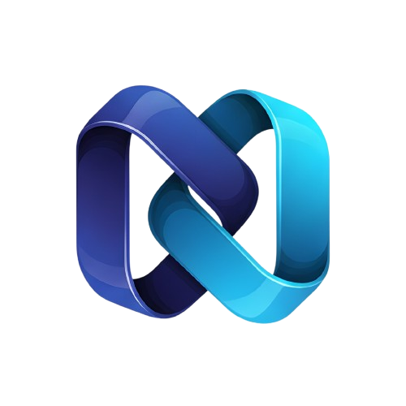

<!-- ═══════════════════════════════════════════════════════════════════════ -->
<!--  MUHAMMAD AFFAN · GitHub Profile README                                -->
<!--  Every project, link and stat below points at something real.          -->
<!-- ═══════════════════════════════════════════════════════════════════════ -->

<p align="center">
  
</p>

<p align="center">
  <a href="https://github.com/Muhammadd-01">
    
  </a>
</p>

<p align="center">
  <a href="https://github.com/Muhammadd-01?tab=followers"></a>
  
  <a href="https://github.com/Muhammadd-01?tab=repositories"></a>
</p>

<p align="center">
  <a href="https://affann-portfolio.vercel.app/"></a>
  <a href="https://www.linkedin.com/in/muhammad-affan-8ab604280"></a>
  <a href="mailto:affan.work05@gmail.com"></a>
  <a href="https://x.com/affann_23"></a>
  <a href="https://www.instagram.com/almuharib._.7/"></a>
  <a href="https://www.facebook.com/profile.php?id=61572493182768"></a>
</p>


## 👋 About Me

I'm **Muhammad Affan**, a developer from **Karachi, Pakistan 🇵🇰** and the founder of **[NexoVate Digital](https://nexovate-digital.vercel.app/)**. I build complete products end to end: web apps with **React / Next.js / Node**, cross-platform mobile apps with **Flutter**, and **Python + FastAPI** services that put machine learning behind a clean UI.

```yaml
currently_building:  AI-powered SaaS tools, Flutter apps & games, client websites at NexoVate Digital
recently_shipped:    UrbanTransit IQ (PySpark + FastAPI analytics) · PixelPunch (Flutter + Flame game)
focus_areas:         Full-Stack Web · Mobile (Flutter) · Applied ML & Data · 2D/3D Games
learning:            Unity 6 multiplayer, local LLMs, scalable backend design
ask_me_about:        MERN, Next.js, Flutter, Firebase / Supabase, FastAPI
outside_code:        Islamic history & philosophy · strategy games
open_to:             Freelance projects, collaborations & full-time roles
motto:               "Ummah first ☝️ · Lifelong learner 📚"
```

## 🏢 NexoVate Digital

<table>
  <tr>
    <td width="90" align="center"></td>
    <td>
      <b>NexoVate Digital</b> is my software studio. We design and build websites, web apps, mobile apps and AI tools for businesses and individuals, from first idea to deployment.<br><br>
      <a href="https://nexovate-digital.vercel.app/"></a>
    </td>
  </tr>
</table>


## 🚀 Featured Projects

<table>
  <tr>
    <td width="50%" valign="top">
      <h3>🚊 <a href="https://github.com/Muhammadd-01/UrbanTransit_IQ">UrbanTransit IQ</a></h3>
      Big-data transit intelligence platform for Karachi: travel patterns, anomaly detection and route clustering with <b>PySpark MLlib</b>, served through <b>FastAPI</b> and a React dashboard.<br><br>
      
      
      
      <br><br>
      <a href="https://urban-transit-iq.vercel.app">🌐 Live demo</a> · <a href="https://github.com/Muhammadd-01/UrbanTransit_IQ">📂 Code</a>
    </td>
    <td width="50%" valign="top">
      <h3>📈 <a href="https://github.com/Muhammadd-01/ProfitLens">ProfitLens</a></h3>
      AI business-intelligence SaaS for small businesses: upload sales data and get forecasting, churn prediction, RFM + K-Means customer segmentation and anomaly detection.<br><br>
      
      
      
      <br><br>
      <a href="https://github.com/Muhammadd-01/ProfitLens">📂 Code</a>
    </td>
  </tr>
  <tr>
    <td width="50%" valign="top">
      <h3>🥊 <a href="https://github.com/Muhammadd-01/Pixel_Punch">PixelPunch</a></h3>
      Cartoon 2D fighting &amp; exploration game with Solo / Duo / Squad modes, a <b>"Villain Lab"</b> that turns a selfie into a playable villain using on-device ML Kit, and a Unity 3D royale mode.<br><br>
      
      
      
      <br><br>
      <a href="https://github.com/Muhammadd-01/Pixel_Punch">📂 Code</a>
    </td>
    <td width="50%" valign="top">
      <h3>⌚ <a href="https://github.com/Muhammadd-01/WatchHub_Project">WatchHub</a></h3>
      Luxury watch e-commerce platform: a cross-platform customer app for iOS &amp; Android plus a web-based admin panel for products, orders and store operations.<br><br>
      
      
      
      <br><br>
      <a href="https://github.com/Muhammadd-01/WatchHub_Project">📂 Code</a>
    </td>
  </tr>
  <tr>
    <td width="50%" valign="top">
      <h3>🦂 <a href="https://github.com/Muhammadd-01/Scorpian_Cursor">Scorpion Cursor</a></h3>
      macOS desktop companion: an articulated, animated scorpion that chases your cursor across every app and Space, with sprint mode and live resizing. Native Swift helper for global mouse tracking.<br><br>
      
      
      
      <br><br>
      <a href="https://github.com/Muhammadd-01/Scorpian_Cursor">📂 Code</a>
    </td>
    <td width="50%" valign="top">
      <h3>📦 <a href="https://github.com/Muhammadd-01/Storelytics">Storelytics</a></h3>
      Retail analytics for pharmacies and general stores: inventory, profit tracking, expiry &amp; low-stock alerts, demand logging and PDF reports with role-based access.<br><br>
      
      
      <br><br>
      <a href="https://github.com/Muhammadd-01/Storelytics">📂 Code</a>
    </td>
  </tr>
  <tr>
    <td width="50%" valign="top">
      <h3>🔎 <a href="https://github.com/Muhammadd-01/AI_Researcher">AI Researcher</a></h3>
      Autonomous research agent that gathers articles, repos and videos on any topic and summarises them with a <b>local LLM</b> (Qwen2.5) running in-memory: no paid APIs.<br><br>
      
      
      
      <br><br>
      <a href="https://github.com/Muhammadd-01/AI_Researcher">📂 Code</a>
    </td>
    <td width="50%" valign="top">
      <h3>🏨 <a href="https://github.com/Muhammadd-01/Hotel_Management_System">AI Hotel Management System</a></h3>
      MERN hotel system with JWT auth, room &amp; booking management, dynamic pricing, Socket.io notifications, PDF invoices and a smart booking assistant that understands English &amp; Roman Urdu.<br><br>
      
      
      
      <br><br>
      <a href="https://github.com/Muhammadd-01/Hotel_Management_System">📂 Code</a>
    </td>
  </tr>
</table>

<details>
  <summary><b>🌐 More live projects (click to expand)</b></summary>
  <br>

| Project | What it is | Links |
|---|---|---|
| **NexoVate Digital** | Agency website for my software studio | [Live](https://nexovate-digital.vercel.app/) · [Code](https://github.com/Muhammadd-01/NexoVate-Digital) |
| **DeenSphere** | Islamic knowledge & community platform: Quran learning, scholars, history, lectures | [Live](https://deen-sphere.vercel.app) · [Code](https://github.com/Muhammadd-01/Deen_Sphere_Website) |
| **DeenVerse** | Islamic AI platform built with React + Vite | [Live](https://deen-verse.vercel.app) · [Code](https://github.com/Muhammadd-01/Islamic-Project) |
| **MediNova Admin Panel** | Admin dashboard for the MediNova healthcare app | [Live](https://medinova-admin-panel.vercel.app) · [Code](https://github.com/Muhammadd-01/MediNova_AdminPanel) |
| **Meridian QM Workspace** | CRM, sales pipeline, projects & reports for ISO consultants and auditors | [Live](https://meridian-quality-management.vercel.app) · [Code](https://github.com/Muhammadd-01/Meridian-Quality-Management) |
| **Meridian LMS** | Course marketplace, learner app & admin console demo | [Code](https://github.com/Muhammadd-01/Meridian_LMS) |
| **FakeGuardAI** | Fake-news detector: TF-IDF model, clickbait & emotion analysis | [Code](https://github.com/Muhammadd-01/Fake_AI_News_Detector) |
| **JobSeeking AI** | React Native app that matches jobs to your CV | [Code](https://github.com/Muhammadd-01/jobSeekingAI) |
| **Rage Hunters** | Mobile-first 3D multiplayer survival game in Unity 6 | [Code](https://github.com/Muhammadd-01/Rage_Hunters) |
| **Portfolio** | Personal portfolio built with Next.js 14 & Framer Motion | [Live](https://affann-portfolio.vercel.app/) · [Code](https://github.com/Muhammadd-01/Affan-sPortolio) |

</details>


## 🛠️ Tech Stack

**Languages**<br>


**Frontend**<br>


**Mobile, Desktop & Games**<br>


**Backend & AI**<br>


**Databases & Cloud**<br>


**Tools**<br>


## 📊 GitHub Stats

<p align="center">
  
  
</p>

<p align="center">
  
</p>

## 🐍 Contribution Snake

<p align="center">
  <picture>
    <source media="(prefers-color-scheme: dark)" srcset="https://raw.githubusercontent.com/Muhammadd-01/Muhammadd-01/output/github-snake-dark.svg">
    <source media="(prefers-color-scheme: light)" srcset="https://raw.githubusercontent.com/Muhammadd-01/Muhammadd-01/output/github-snake.svg">
    
  </picture>
</p>


<h3 align="center">🤝 Let's build something together</h3>

<p align="center">
  Have a project in mind or want to collaborate? <a href="mailto:affan.work05@gmail.com"><b>Email me</b></a> or reach out on <a href="https://www.linkedin.com/in/muhammad-affan-8ab604280"><b>LinkedIn</b></a>.<br>
  If something here helped or inspired you, a <b>⭐ star</b> on the repo and a <b>follow</b> are always appreciated!
</p>

<p align="center">
  <a href="https://github.com/Muhammadd-01?tab=followers"></a>
</p>

<p align="center">
  
</p>
